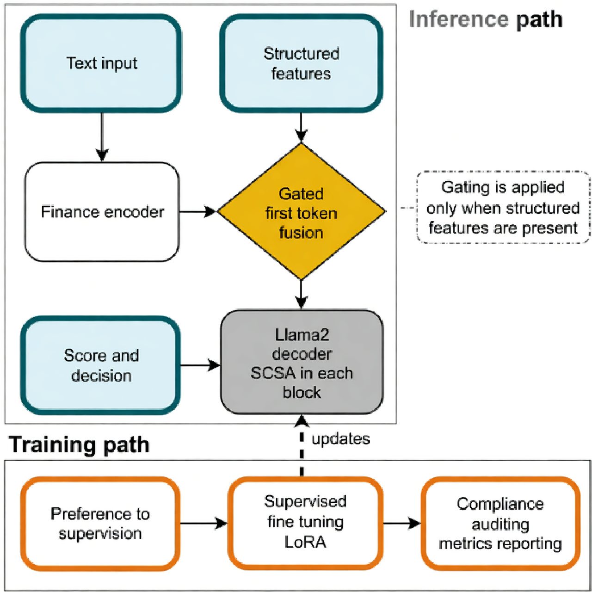

# CoVALend: A Value-Alignment Pipeline for Compliant Micro-Lending

[](https://www.python.org/downloads/)
[](https://pytorch.org/)
[](https://opensource.org/licenses/MIT)
[](https://github.com/Jackksonns)

**CoVALend** (formerly Fiducia) is a compliance-aware value alignment pipeline built on LLaMA-2-7B for microloan and small loan credit assessment. It combines minimal-intrusion tabular-text fusion with fairness-aware learning to enable transparent and auditable credit scoring.

## Model Architecture

<div align="center">
  
</div>

## Overview

CoVALend addresses value bias and limited auditability in credit scoring through:

1. **Finance Encoder**: Low-intrusion tabular-text fusion via first token replacement with missing value gating
2. **SCSA Module**: Lightweight attention recalibration for fairness-aware representation learning
3. **Two-Stage Training**: Warm-up followed by value-alignment refinement with LoRA fine-tuning
4. **Compliance-Oriented Evaluation**: Reports predictive performance (Accuracy, F1, MCC, Miss) and fairness metrics (EOD, AOD, DI)

## Key Features

- **Minimal Intrusion**: Adds Finance Encoder and SCSA without modifying LLaMA backbone
- **Fairness-Aware**: Integrated fairness metrics (EOD, AOD, Disparate Impact)
- **Credit-Specific**: Optimized for microloan default prediction
- **Reproducible**: Fixed seeds, comprehensive config, auditable evaluation
- **Efficient**: LoRA fine-tuning on single GPU (24GB VRAM)

## Installation

### Requirements

- Python 3.8+
- CUDA 11.0+ (for GPU)
- 24GB+ VRAM (RTX 4090 / A100)
- 32GB+ RAM

### Setup

```bash
# Clone repository
git clone https://github.com/Jackksonns/CoVALend.git
cd CoVALend

# Create virtual environment
python -m venv venv
source venv/bin/activate  # Windows: venv\Scripts\activate

# Install dependencies
pip install -r requirements.txt
```

## Quick Start

```python
from covalend import CovalendModel, CovalendConfig
from transformers import AutoTokenizer

# Initialize model
config = CovalendConfig(
    base_model_name="meta-llama/Llama-2-7b-hf",
    use_finance_encoder=True,
    use_scsa=True
)

model = CovalendModel(config)
tokenizer = AutoTokenizer.from_pretrained(config.base_model_name)

# Make prediction
text = "Applicant has income $50000, credit score 720..."
inputs = tokenizer(text, return_tensors="pt")

result = model.predict(
    input_ids=inputs['input_ids'],
    attention_mask=inputs['attention_mask']
)

print(f"Prediction: {result['predictions'].item()}")
```

## Datasets

Publicly available credit datasets used:

1. **[Lending Club 2007-2018](https://www.kaggle.com/datasets/wordsforthewise/lending-club)** (Primary)
2. **[Statlog German Credit](http://archive.ics.uci.edu/dataset/144/statlog+german+credit+data)**
3. **[Statlog Australian Credit](http://archive.ics.uci.edu/dataset/143/statlog+australian+credit+approval)**
4. **[Home Credit Default Risk](https://www.kaggle.com/competitions/home-credit-default-risk/data)**

### Data Preprocessing

```bash
# Convert CSV to model format
python dataset/csv_to_json.py \
    --input data/raw/lending_club.csv \
    --output data/processed/train.json
```

See [dataset/README.md](dataset/README.md) for details.

## Citation
Waiting for updation...

## Contact

**Maintainer:** Hongyi Zhou

- Email: h.zhou.23@abdn.ac.uk
- GitHub: [@Jackksonns](https://github.com/Jackksonns)

**Affiliations:**
- Aberdeen Institute of Data Science and AI, South China Normal University
- Business School, University of Aberdeen

## Acknowledgments

- LLaMA-2 by Meta AI
- Transformers by Hugging Face
- SCSA module inspirement
- Fairness metrics based on AI Fairness 360

## LLaMA-2 Weights & Usage Disclaimer

The LLaMA-2 model weights are not included in this repository. Users must apply for and download the weights directly from the [Meta AI website](https://ai.meta.com/llama/). 

**Usage Policy:**
This project relies on LLaMA-2-7B. By using this code, you agree to comply with the [Meta LLaMA 2 Community License Agreement](https://ai.meta.com/llama/license/). This repository and the associated work are intended **solely for academic research purposes** and must not be used for commercial purposes.

---

© 2026 CoVALend Team | Made for Responsible AI in Finance
